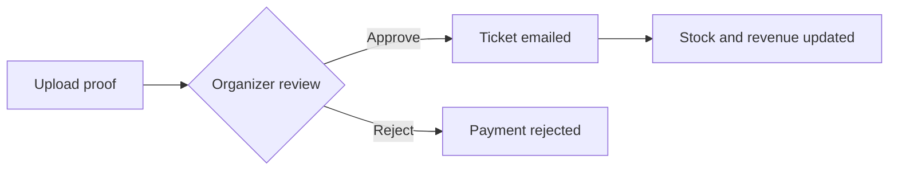

# Felicity

An event management platform for a college fest. Participants browse events, register
and get a QR ticket by email. Organizers publish events, check people in and track
revenue. An admin manages the organizers.

Live: https://dass-assignment-1-six.vercel.app/

Built with React, Node.js, Express and MongoDB.

## Features

**Participants**
- Browse and search events, with fuzzy matching
- Register for events and buy merchandise
- Get a ticket with a QR code by email
- Follow organizers and receive notifications

**Organizers**
- Create and publish events, announced automatically on Discord
- Scan QR codes with the device camera to mark attendance, with manual entry as a backup
- Review payment proofs for merchandise and approve or reject them
- See registrations, check-ins, revenue and remaining stock

**Admins**
- Add and manage organizers
- Approve or reject organizer password reset requests

**Everyone registered for an event**
- A live discussion forum for that event, with `@everyone` mentions

## How a few parts work

**Authentication.** Logins use JWTs that carry the user's ID and role, and middleware
checks the role on protected routes. Passwords are hashed with bcrypt. Signup and login
are protected by reCAPTCHA v3, with a score threshold of 0.5.

**Tickets and attendance.** On registration the server creates a QR code holding the
registration ID and emails it as an attachment. When an organizer scans it, the server
validates the registration, rejects duplicates and updates the attendance count.

**Merchandise payments.** The participant uploads a payment proof and the organizer
reviews it. On approval the ticket is issued and emailed, stock goes down and revenue
is updated.



**Forum.** Each event has its own Socket.IO room. Messages are saved in MongoDB and then
broadcast to the room, so they are still there after a refresh or a server restart.

**Password resets.** An organizer sends a request with a reason and the admin reviews it.
On approval the server generates a random password with `crypto.randomBytes`, stores its
bcrypt hash and emails the new password. On rejection the admin's reason is emailed
instead. Every request stays in the admin's history.

## Stack

| Part | Tools |
|---|---|
| Frontend | React 19, Vite, Socket.IO client, html5-qrcode, plain CSS |
| Backend | Node.js, Express 5, Socket.IO, Mongoose, JWT, bcrypt, Nodemailer, qrcode, Fuse.js |
| Database | MongoDB Atlas |
| Other services | Google reCAPTCHA v3, Discord webhooks |
| Hosting | Vercel (frontend), Render (backend) |

## Running it locally

You need Node.js and a MongoDB database.

```
git clone https://github.com/Nikhith-2025/Felicity-Management-System.git
cd Felicity-Management-System
```

Backend:

```
cd backend
npm install
npm run dev
```

Create `backend/.env` first:

```
MONGO_URI=your_mongodb_connection_string
JWT_SECRET=your_jwt_secret_key
EMAIL_USER=your_email@gmail.com
EMAIL_PASS=your_app_password
RECAPTCHA_SECRET_KEY=your_recaptcha_secret
DISCORD_WEBHOOK_URL=your_discord_webhook_url
PORT=5000
```

Frontend, in a second terminal:

```
cd frontend
npm install
npm run dev
```

Create `frontend/.env` first:

```
VITE_API_URL=http://localhost:5000/api
VITE_RECAPTCHA_SITE_KEY=your_recaptcha_site_key
```

Then open http://localhost:5173.
